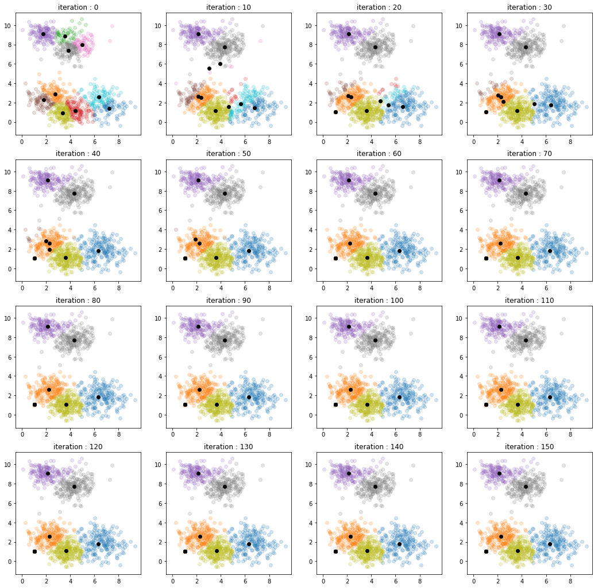

# Variational Inference

Notebook implementations of examples from **Pattern Recognition and Machine Learning (PRML)**, covering Gaussian mixtures, Bayesian linear regression, and Bayesian logistic regression.

[Explore the notebooks](#notebooks) · [Implementation notes](docs/NOTES.md) · [PRML book](https://www.microsoft.com/en-us/research/people/cmbishop/#!prml-book)



*Saved iteration plots from [mixture of gaussians.ipynb](mixture%20of%20gaussians.ipynb). Colored points show component assignments; black points mark the plotted component centers.*

## Notebooks

| Example | What is included |
| --- | --- |
| [Gaussian mixtures](mixture%20of%20gaussians.ipynb) | Synthetic 2D data, K-means initialization, variational updates, and iteration plots |
| [Linear regression](linear%20regression.ipynb) | Polynomial basis functions, updates for weight and precision distributions, predictive plots, and ELBO calculations |
| [Logistic regression](logistic%20regression.ipynb) | Synthetic two-class data, a Gaussian variational posterior, parameter updates, and probability-colored predictions |

The code includes PRML equation references alongside the update functions. Each notebook generates its own data.

## Open locally

Dependencies are **NumPy, SciPy, Matplotlib, and Jupyter**, plus **scikit-learn** for K-means initialization in the Gaussian-mixture example.

```sh
git clone https://github.com/scpark20/variational-inference.git
cd variational-inference
python -m pip install jupyter numpy scipy matplotlib scikit-learn
jupyter notebook
```

The notebooks record Python 3.6.3 in their metadata and retain their original saved outputs. The linear-regression result cell needs explicit parameter definitions in a fresh kernel; see the [implementation notes](docs/NOTES.md) for this and other details to review before reusing the calculations. The figures are existing notebook outputs, not results of a new validation run.

## Reference and license

Christopher M. Bishop, [*Pattern Recognition and Machine Learning*](https://www.microsoft.com/en-us/research/people/cmbishop/#!prml-book).

This repository includes the [GNU General Public License v3.0](LICENSE).
